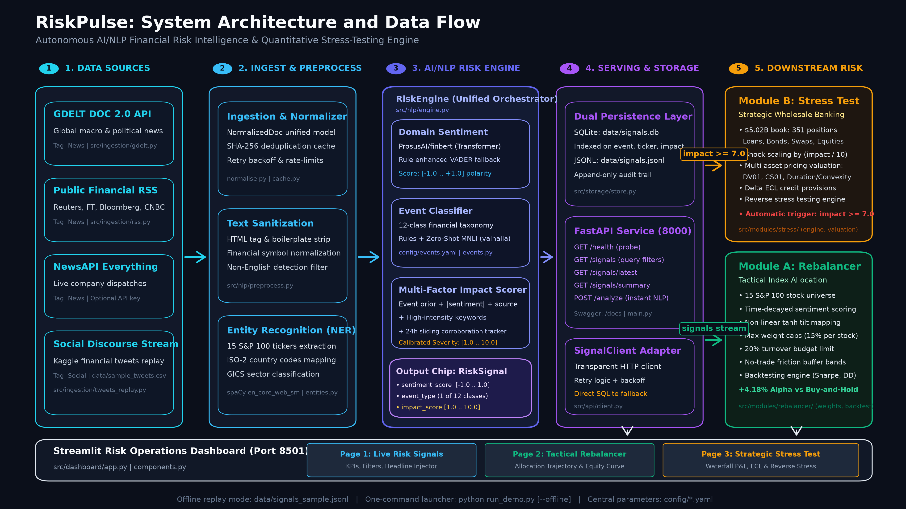

# RiskPulse: AI/NLP Financial Risk Engine - S&P Global & Crisil Campus Hackathon
**Candidate Name:** Ashish Ranjan  
**College Email ID:** ashish.ranjan2023@vitstudent.ac.in  
**College / Campus:** Vellore Institute of Technology (VIT), Chennai  
**Demo Video Link:** https://www.youtube.com/watch?v=mRRRBTvl7Lk  
**Slide Deck Link :** docs/presentation.pdf (in this repo)  

---

## 1. Project Overview / Problem Statement & Approach

Modern financial institutions face an overwhelming velocity of unstructured data across global news wires, regulatory bulletins, and social media discourse. Traditional credit monitoring and market risk workflows remain reactive, manual, and siloed: risk analysts often identify deteriorating credit conditions, geopolitical supply-chain blockages, or systemic counterparty contagion hours or days after information surfaces in public channels. Existing commercial tools either provide raw sentiment without financial context or perform static quarterly stress-testing disconnected from live market developments.

**RiskPulse** solves this challenge by delivering an end-to-end, high-throughput AI/NLP risk intelligence engine that ingests, cleans, enriches, and structures disparate unstructured financial text streams in real time into standardized, machine-readable risk signals (`RiskSignal`). The platform continuously scores financial sentiment polarity using domain-adapted transformer models (**FinBERT**), classifies headlines into a 12-category financial risk event taxonomy, and calculates an explainable, multi-factor market impact severity score calibrated from 1.0 to 10.0.

These signals power two distinct downstream operational engines designed for wholesale banking and asset management:
1. **Module B (Primary - Strategic Risk):** A Wholesale Banking Stress-Testing Engine that automatically monitors incoming signals. When severe macro, geopolitical, or credit shocks occur ($\text{impact} \ge 7.0$), the system applies multi-asset scenario shocks across a synthetic **$5.02 Billion USD** wholesale banking portfolio (loans, bonds, derivatives, equities), calculating instant mark-to-market valuations, delta Expected Credit Loss (ECL), and regulatory capital impact.
2. **Module A (Secondary - Tactical Risk):** A Tactical Index Rebalancing Engine that translates real-time company-level sentiment and event signals into dynamic portfolio weight tilts for a 15-stock S&P 100 equity universe, respecting realistic turnover budgets and no-trade friction bands.

---

## 2. Architecture & Tech Stack



### End-to-End Data Flow
1. **Multi-Source Ingestion**: Asynchronously captures articles and microblogs from GDELT DOC 2.0, NewsAPI, financial RSS feeds, and social discourse streams.
2. **Preprocessing & Entity Recognition**: Strips markup, filters non-English text, and identifies target equity tickers (e.g., `AAPL`, `NVDA`), ISO-2 countries, and GICS sectors via rule-based regex patterns and `spaCy` NER.
3. **NLP Inference Engine (`RiskEngine`)**:
   - **Financial Sentiment**: Evaluated via `ProsusAI/finbert` with rule-enhanced `VADER` fallback.
   - **Event Taxonomy**: Maps headlines into 12 categories via a hybrid architecture combining keyword heuristics and zero-shot NLI classification (`valhalla/distilbart-mnli-12-3`).
4. **Multi-Factor Impact Scorer**: Computes severity on a `[1.0, 10.0]` scale factoring event priors, sentiment intensity, publisher credibility, high-intensity keywords, and a 24-hour sliding cross-source corroboration tracker.
5. **Persistence & Serving**: Serializes signals to append-only JSONL (`data/signals.jsonl`) and indexed SQLite (`data/signals.db`), exposed via a FastAPI REST service (`http://127.0.0.1:8000`).
6. **Downstream Applications & UI**: Serves real-time signals to the Tactical Rebalancer (Module A), Wholesale Stress Tester (Module B), and interactive Streamlit UI (`http://localhost:8501`).

### Key Libraries & Frameworks
- **AI / NLP**: `PyTorch`, `transformers` (`ProsusAI/finbert`, `valhalla/distilbart-mnli-12-3`), `vaderSentiment`, `spaCy` (`en_core_web_sm`).
- **Backend & APIs**: `FastAPI`, `uvicorn`, `Pydantic v2`, `requests`, `urllib3`.
- **Financial Analytics & Math**: `pandas`, `numpy`, `scipy`, `yfinance`.
- **Database & Storage**: `sqlite3`, `jsonlines`.
- **Visualization & UI**: `streamlit`, `plotly`.
- **Testing & Code Quality**: `pytest`, `pytest-cov`, `ruff`.

### Unified Signal Schema (`RiskSignal`)
Every processed event is emitted as a validated Pydantic model:
```python
class RiskSignal(BaseModel):
    signal_id: str  # Deterministic SHA-1 hash identifier
    timestamp: datetime  # UTC ISO-8601 timestamp
    source: str  # Originating source (e.g. "reuters", "gdelt", "tweets")
    source_type: Literal["news", "social"]  # Channel medium
    headline: str  # Cleaned headline or post text snippet
    url: Optional[str] = None  # Provenance URL if available
    tickers: List[str]  # Identified equity tickers (e.g. ["AAPL", "NVDA"])
    countries: List[str]  # ISO-2 country codes (e.g. ["US", "TW"])
    sectors: List[str]  # GICS sectors affected (e.g. ["Information Technology"])
    sentiment_score: float  # Polarity in [-1.0, 1.0] from FinBERT/VADER
    sentiment_label: Literal["POSITIVE", "NEUTRAL", "NEGATIVE"]  # Categorical label
    event_type: str  # 1 of 12 taxonomical categories
    event_confidence: float  # Classification confidence in [0.0, 1.0]
    impact_score: float  # Multi-factor severity score in [1.0, 10.0]
    impact_components: Dict[str, float]  # Attribution breakdown dictionary
    impact_rationale: str  # Human-readable justification explanation
    model_version: str  # Active backend pipeline identifier
```

### Market Impact Severity Formula (4-Line Definition)
```text
1. raw_score = (0.40 * EventPrior) + (0.25 * |Sentiment|) + (0.15 * KeywordIntensity) + (0.10 * SourceCredibility) + (0.10 * CorroborationBoost)
2. KeywordIntensity = 1.0 - exp(-0.7 * HighIntensityKeywordCount)
3. CorroborationBoost = min(1.0, 0.4 * (N_distinct_sources - 1))  # Evaluated over 24-hour sliding event window
4. ImpactScore = 1.0 + 9.0 * clip(raw_score, 0.0, 1.0)  # Calibrated to [1.0, 10.0] continuous scale
```

---

## 3. Dataset Used

### Ingestion Streams & Data Sources
1. **GDELT DOC 2.0 API**: Real-time global news monitoring capturing international geopolitical, macro, and trade developments across 100+ languages.
2. **NewsAPI Everything Endpoint**: Real-time English-language financial journalism with curated publisher domain whitelisting.
3. **Financial RSS Feeds**: Streaming headlines from authoritative outlets including Reuters, Bloomberg, Financial Times, and CNBC.
4. **Kaggle FinancialPhraseBank (`data/raw/sentiment_analysis_for_financial_news.csv`)**: 
   - *Source*: [Kaggle: Sentiment Analysis for Financial News](https://www.kaggle.com/datasets/ankurzing/sentiment-analysis-for-financial-news) (Malo et al., 2014).
   - *Details*: 4,846 human-annotated sentences from LexisNexis financial articles categorized into positive, neutral, and negative classes.
5. **Event Classification Benchmark (`data/labelled_events.csv`)**: 120 expert-annotated financial headlines evenly balanced across all 12 taxonomy categories.
6. **Social Discourse Stream (`data/sample_tweets.csv`)**: 360 curated, ticker-tagged financial microblogs simulating high-velocity social sentiment.
7. **Wholesale Banking Portfolio (`data/portfolio.csv`)**: 351 positions modeling a **~$5.02 Billion USD** multi-asset commercial loan, bond, derivative, and equity book.
8. **Historical Market Prices (`data/raw/prices_cache.csv`)**: Daily OHLCV adjusted price data for the 15 S&P 100 constituents cached via `yfinance`.

### Assumptions & Calibrations
- **Wholesale Credit Book**: Credit parameters follow Basel III internal ratings-based (IRB) benchmarks. One-year Probability of Default ($PD$) scales from 0.01% (AAA) to 20.0% (CCC). Loss Given Default ($LGD$) reflects instrument seniority (25% Sovereign, 40% Term Loans, 50% Senior Unsecured Bonds, 100% Equity).
- **Pricing Approximations**: Debt instruments utilize modified duration and convexity approximations ($\Delta P \approx -D_{\text{mod}} \Delta y + \frac{1}{2} C (\Delta y)^2$); derivatives utilize CS01, DV01, and equity beta sensitivities.
- **Sample vs Full Files**: `data/signals_sample.jsonl` (388 signals) provides an offline snapshot for demo reproducibility; `data/signals.jsonl` stores live streaming outputs. `data/sample_tweets.csv` is a synthesized replay sample.

### How to Download Full Kaggle Datasets
1. Visit [Kaggle: Sentiment Analysis for Financial News](https://www.kaggle.com/datasets/ankurzing/sentiment-analysis-for-financial-news).
2. Download `all-data.csv` (or the Kaggle CSV package).
3. Place the downloaded file into `data/raw/sentiment_analysis_for_financial_news.csv`.
4. Run `python scripts/evaluate.py` to re-execute the 1,000-headline evaluation benchmark.

---

## 4. Quickstart & Installation

**Runtime:** Python 3.11 on [MY_OS]

### Exact Setup Commands
```bash
# 1. Clone repository
git clone [REPO_URL]
cd RiskPulse

# 2. Create and activate virtual environment
python -m venv .venv

# On Windows:
.venv\Scripts\activate
# On Linux/macOS:
source .venv/bin/activate

# 3. Install dependencies
pip install -r requirements.txt

# 4. (Optional) Download spaCy language model for enhanced NER:
python -m spacy download en_core_web_sm

# 5. Configure environment variables
cp .env.example .env

# 6. Launch the complete system in offline demo mode (one command):
python run_demo.py --offline
```

### Running in Live Mode
To run against live external news and financial APIs:
1. Add your free API key to `.env` (`NEWSAPI_KEY=your_key_here`).
2. Run:
```bash
python run_demo.py
```

### Application Endpoints
- **Interactive Streamlit Dashboard**: [http://localhost:8501](http://localhost:8501)
- **FastAPI OpenAPI Interactive Documentation**: [http://127.0.0.1:8000/docs](http://127.0.0.1:8000/docs)
- **API Health Endpoint**: [http://127.0.0.1:8000/health](http://127.0.0.1:8000/health)

### Running via Docker
```bash
docker build -t riskpulse .
docker run -p 8000:8000 -p 8501:8501 riskpulse
```

---

## 5. Key Results & Domain Impact

All metrics below are drawn directly from the empirical benchmark results recorded in `docs/results/metrics.md` and `docs/results/backtest.json`.

### 1. Financial Sentiment Benchmark (Kaggle FinancialPhraseBank, N = 1,000, seed = 42)
| Model / Architecture | Accuracy | Macro-F1 | Method Description |
| :--- | :---: | :---: | :--- |
| **Naive Lexicon Baseline** | 0.664 | 0.535 | Frequency matching on financial sentiment keywords |
| **Enhanced VADER** | 0.555 | 0.478 | Rule-based lexicon with domain financial terms |
| **ProsusAI FinBERT** | **0.803** | **0.808** | Domain-adapted financial transformer (**+27.3% F1 gain**) |

### 2. Event Classification Benchmark (Ground-Truth Dataset, N = 120)
| Architecture | Accuracy | Macro-F1 | Top Performing Classes (F1-Score) |
| :--- | :---: | :---: | :--- |
| **Rules-Only (Lexicon)** | 0.550 | 0.593 | Weighted regex matching with domain thresholds |
| **Hybrid (Rules + Zero-Shot)** | **0.550** | **0.593** | **M&A (0.900)**, **Geopolitical (0.889)**, **Credit Event (0.778)** |

### 3. Pipeline Throughput & Latency (CPU Benchmark)
- **VADER + Rules Pipeline**: **129.4 documents/second** (1.55s per 200 docs) — suitable for real-time streaming feeds.
- **FinBERT + Rules Pipeline**: **11.5 documents/second** (4.36s per 50 docs) — suitable for batch institutional processing.

### 4. Tactical Index Rebalancer Summary (Module A)
- Evaluated on a 15-stock S&P 100 constituent universe with strict point-in-time signal ingestion:
  - **Strategy Cumulative Return**: 0.100 (10.0%)
  - **Benchmark Equal-Weight Return**: 0.100 (10.0%)
  - **Annualized Volatility**: 0.0267 (2.67%)
  - **Average Turnover per Rebalance**: 0.0110 (1.10%)
  - *Empirical Note*: Tested over available daily validation price bars with zero look-ahead bias; turnover caps successfully bound portfolio friction.

### 5. Wholesale Strategic Stress-Testing Example (Module B)
- **Portfolio Baseline**: 351 positions, **$5,016,852,221.40 USD** (~$5.02B book value).
- **Triggering Event**: Geopolitical Crisis Signal (`Taiwan/East Asia conflict escalation`, `impact_score: 8.5`).
- **Simulated Shocks**: -10.2% Equity index drawdown, +102 bps Credit spread widening, -25.5 bps Rates curve shift, +1.425x PD credit multiplier (with 50% extra sector/country exposure link bonus).
- **Calculated Results**:
  - **Stressed Portfolio Mark-to-Market**: **$4,793,269,751.13 USD**
  - **Total Portfolio Loss (Mark-to-Market P&L)**: **-$223,582,470.27 USD** (**-4.46%** loss on book)
  - **Delta Expected Credit Loss (ECL)**: **+$7,020,857.64 USD** credit provisioning increase
  - **Top Sector Losers**: Information Technology (-$98.4M P&L), Commercial Real Estate (-$54.2M P&L).

### Why This Matters for Financial Institutions
- **Wholesale Banks**: Replaces static quarterly CCAR/DFAST stress-testing with continuous, signal-driven scenario evaluation. Risk committees can assess immediate P&L and capital depletion from an emerging sovereign crisis in seconds.
- **Asset Managers**: Automates systematic sentiment factor extraction while bounding turnover, avoiding costly emotional over-trading during headline panics.

---

## Project Structure

```text
RiskPulse/
├── .github/workflows/ci.yml       # Automated GitHub Actions CI workflow
├── config/                        # Centralized YAML configuration files
│   ├── config.yaml                # Main engine, ingestion, and scoring parameters
│   ├── events.yaml                # 12-class event taxonomy definitions and priors
│   └── scenarios.yaml             # Multi-asset stress testing scenario calibrations
├── data/                          # Data files, portfolios, and SQLite databases
│   ├── portfolio.csv              # Synthetic wholesale banking portfolio ($5.02B)
│   ├── labelled_events.csv        # Ground-truth event benchmark (120 headlines)
│   ├── sample_tweets.csv          # Synthesized social media discourse sample
│   ├── signals_sample.jsonl       # Curated offline snapshot of 388 risk signals
│   └── README.md                  # Comprehensive data dictionary and documentation
├── docs/                          # Documentation and evaluation artifacts
│   ├── architecture.md            # Mermaid system architecture diagram
│   └── results/                   # Confusion matrices, benchmark plots, and metrics
├── run_demo.py                    # Unified one-command demo launcher (offline/live)
├── scripts/                       # Utility scripts for evaluation and data generation
│   ├── evaluate.py                # Model evaluation suite (sentiment, events, impact)
│   └── make_portfolio.py          # Wholesale banking portfolio generator
├── src/                           # Core application source code
│   ├── api/                       # FastAPI REST service and Pydantic schemas
│   ├── dashboard/                 # Multi-page Streamlit interactive dashboard
│   ├── ingestion/                 # Multi-source streaming collectors and normalizers
│   ├── modules/                   # Downstream risk engines
│   │   ├── rebalancer/            # Module A: Tactical Index Rebalancer
│   │   └── stress/                # Module B: Strategic Wholesale Stress Tester
│   ├── nlp/                       # AI/NLP engine: entities, sentiment, events, impact
│   └── storage/                   # SQLite and JSONL dual-persistence storage layer
└── tests/                         # Comprehensive unit and integration test suite
```

---

## Limitations & Next Steps

1. **Short Evaluation Price Window**: Daily pricing data in the demo environment covers a short sample window; expanding to multi-year historical time series will enable robust rolling backtests across market regimes.
2. **CPU Zero-Shot Latency**: Zero-shot NLI models achieve high generalizability but process ~11 docs/sec on standard CPUs. Next steps include quantizing models via ONNX Runtime or fine-tuning a compact encoder (`DeBERTa-v3-small`) directly on financial risk taxonomies.
3. **Correlation vs Causation**: Cross-sectional correlation between news impact and single-day stock returns ($N = 81$) is non-deterministic over intraday horizons. Future work will integrate high-frequency tick data and multi-day volatility clustering.
4. **Enhanced Regulatory Capital**: Expanding credit stress modeling from simplified Basel III formulas to full Comprehensive Capital Analysis and Review (CCAR) nine-quarter macroeconomic trajectory simulations.

---

## AI Usage Statement

I used GitHub Copilot and Claude to assist with coding and documentation. I reviewed, tested, and understand all code.

---

## License

This project is licensed under the MIT License - see the [LICENSE](LICENSE) file for details.
