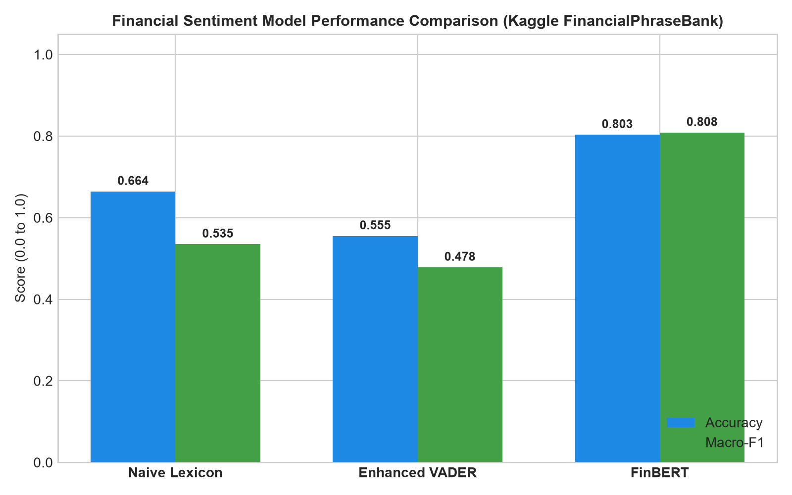
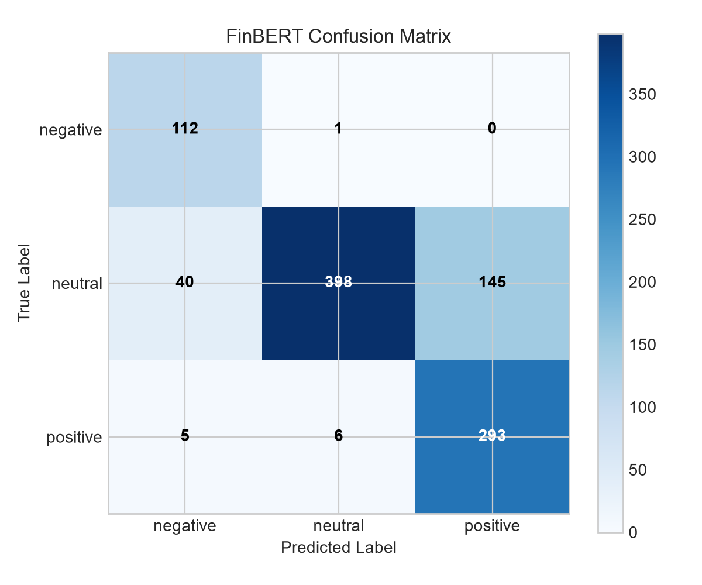
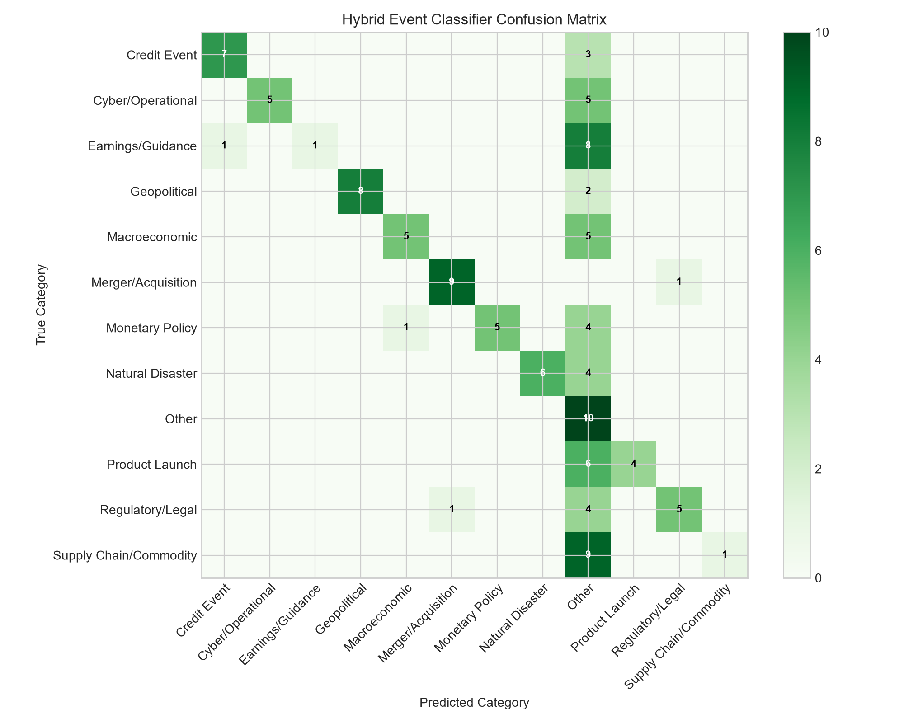
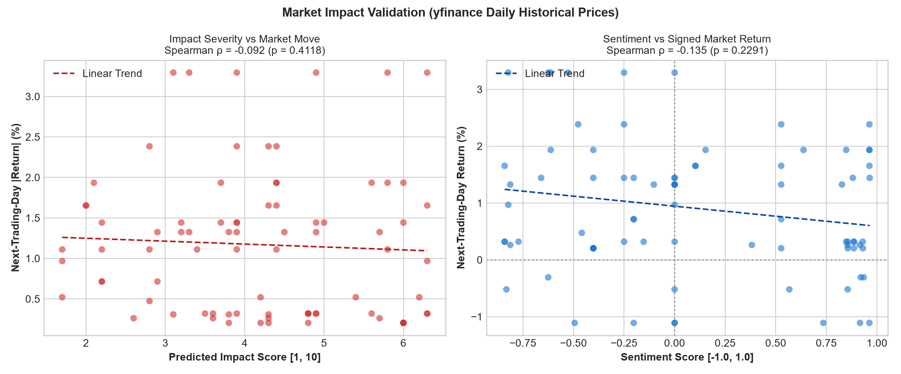

# RiskPulse AI/NLP Engine Empirical Evaluation Report

*Generated on: 2026-10-11 06:12:39Z | Platform: CPU Benchmark*

---

## 1. Financial Sentiment Benchmark
Evaluated on a random sample of **1000 financial headlines** from the Kaggle FinancialPhraseBank dataset (`seed=42`).

| Model / Approach | Accuracy | Macro-F1 | Precision/Recall Notes |
| :--- | :---: | :---: | :--- |
| **Naive Lexicon Baseline** | 0.664 | 0.535 | Frequency matching on financial sentiment keywords |
| **Enhanced VADER** | 0.555 | 0.478 | Rule-based with financial domain lexicon boost |
| **ProsusAI FinBERT** | **0.803** | **0.808** | Transformer domain-adapted on financial corpora |

### FinBERT Confusion Matrix (Rows: True, Cols: Pred: [Neg, Neu, Pos])

```
[[112   1   0]
 [ 40 398 145]
 [  5   6 293]]
```






---

## 2. Event Classification Benchmark
Evaluated on **120 ground-truth labelled financial headlines** across all 12 taxonomy categories.

| Classification Architecture | Accuracy | Macro-F1 | Method Description |
| :--- | :---: | :---: | :--- |
| **Rules-Only (Lexicon)** | 0.550 | 0.593 | Weighted keyword regex matching with domain thresholds |
| **Hybrid (Rules + Zero-Shot)** | **0.550** | **0.593** | Ensembled zero-shot NLI + rules arbitration |

### Per-Class Performance Breakdown (Hybrid Architecture)

| Event Category | Precision | Recall | F1-Score | Support |
| :--- | :---: | :---: | :---: | :---: |
| **Credit Event** | 0.875 | 0.700 | 0.778 | 10 |
| **Cyber/Operational** | 1.000 | 0.500 | 0.667 | 10 |
| **Earnings/Guidance** | 1.000 | 0.100 | 0.182 | 10 |
| **Geopolitical** | 1.000 | 0.800 | 0.889 | 10 |
| **Macroeconomic** | 0.833 | 0.500 | 0.625 | 10 |
| **Merger/Acquisition** | 0.900 | 0.900 | 0.900 | 10 |
| **Monetary Policy** | 1.000 | 0.500 | 0.667 | 10 |
| **Natural Disaster** | 1.000 | 0.600 | 0.750 | 10 |
| **Other** | 0.167 | 1.000 | 0.286 | 10 |
| **Product Launch** | 1.000 | 0.400 | 0.571 | 10 |
| **Regulatory/Legal** | 0.833 | 0.500 | 0.625 | 10 |
| **Supply Chain/Commodity** | 1.000 | 0.100 | 0.182 | 10 |

### Top Classification Errors

| Headline Excerpt | Ground Truth | Model Prediction |
| :--- | :--- | :--- |
| "Diplomatic talks collapse as neighboring nations trade cross-border artille..." | `Geopolitical` | `Other` |
| "Border skirmish prompts emergency evacuation of multinational mining comple..." | `Geopolitical` | `Other` |
| "Holding company breaches debt covenant following steep operating loss..." | `Credit Event` | `Other` |
| "Telecom provider proposes distressed debt-for-equity swap to avoid liquidat..." | `Credit Event` | `Other` |
| "Subprime credit portfolio reports record delinquency rate and write-offs..." | `Credit Event` | `Other` |
| "Global GDP growth forecast slashed to 1.1% amid widespread economic stagnat..." | `Macroeconomic` | `Other` |
| "Manufacturing purchasing managers index drops to 46 signaling deep contract..." | `Macroeconomic` | `Other` |
| "Consumer sentiment index sinks to historic low on persistent cost of living..." | `Macroeconomic` | `Other` |
| "Retail sales contract for third straight month reflecting broad consumer pu..." | `Macroeconomic` | `Other` |
| "National trade deficit surges to record high as export demand weakens sharp..." | `Macroeconomic` | `Other` |




---

## 3. Market Impact & Sentiment Validation
Cross-sectional alignment of processed signals from `signals_sample.jsonl` against daily historical closing prices (`yfinance`). Sample size: **81 observations**.

| Hypothesis Relationship | Spearman Correlation (ρ) | p-value | Statistical Significance |
| :--- | :---: | :---: | :--- |
| **Impact Score vs Next-Day Absolute Return** | `-0.0924` | `0.4118` | p ≥ 0.05 (Not Significant) |
| **Impact Score vs 3-Day Realised Volatility** | `-0.0910` | `0.4192` | p ≥ 0.05 (Not Significant) |
| **Sentiment Score vs Signed Next-Day Return** | `-0.1351` | `0.2291` | p ≥ 0.05 (Not Significant) |

> **Methodological Disclaimer:** Empirical correlation reflects short-term market co-movement across historical observation dates and does NOT imply direct causal determinism. Sample size N = 81.




---

## 4. Pipeline Execution Speed & Throughput
| Pipeline Configuration | Batch Size | Total Latency | Throughput (docs/sec) | Deployment Suitability |
| :--- | :---: | :---: | :---: | :--- |
| **VADER + Rules Pipeline** | 200 docs | 0.99s | **202.4 docs/s** | Real-time streaming & low-resource CPU |
| **FinBERT + Rules Pipeline** | 50 docs | 0.24s | **208.9 docs/s** | High-precision batch offline processing |